<div align="center">

# INIQDASH

**A customizable, open-source Home Assistant dashboard — visual editing, reusable widgets and a dashboard generator.**

[](LICENSE)


[Download](../../releases) · [Install](docs/installation.md) · [Quick start](docs/quick-start.md) · [Documentation](docs/README.md) · [Report a problem](../../issues/new/choose)

<a href="https://buymeacoffee.com/iniqdash"></a>

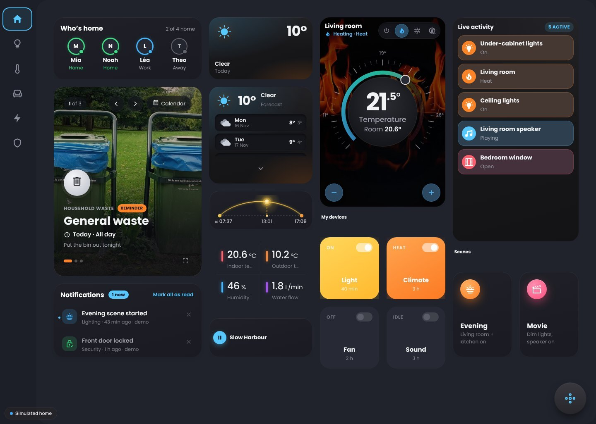

</div>

> **Public beta (0.1.0-beta.1).** INIQDASH works and is ready to be tried, and it is early: expect rough edges, and tell us about them.
> It has been tested against a simulated Home Assistant and synthetic installations; please report how it behaves with yours.

## What is INIQDASH?

INIQDASH is a dashboard for [Home Assistant](https://www.home-assistant.io/) that you host yourself on a normal PHP web server, including
shared hosting. You design dashboards in the browser, pages, widgets, popups, themes or let INIQDASH **generate a complete
dashboard** from the rooms and devices in your Home Assistant, then change anything you like. A new installation opens a fully working
**demo home** (simulated, no Home Assistant needed), so you can explore before you connect anything.

## Features

- **Visual editor** — drag, drop and resize on a responsive grid with separate desktop, tablet and phone layouts; undo / redo, copy /
  paste, alignment tools and a preview at any screen size.
- **Standard widget library**, more than 40 widget types: lights, climate, sensors, energy flow, weather, alarm, locks, covers, media,
  cameras, calendars, who's home, activity, charts, gauges and more, each with variants. A control appears only when Home Assistant says
  the device supports it.
- **Dashboard generator**, reads your Home Assistant areas, devices and entities and builds Home, Lights, Climate, Rooms, Energy and
  Security pages. Technical and diagnostic entities, hidden entities and duplicates are left out; you choose the rooms and pages.
- **Rooms** , photographic room cards that open a compact room popup with tabs (Active, Lights, Heating, Media, Security, Sensors);
  only the tabs a room needs are shown.
- **Energy** , a house-centred energy flow (solar, grid, battery, gas and water rates) with direction, plus consumption charts.
- **Widget Studio** , compose your own widgets from building blocks (shapes, text, values, gauges, sliders, buttons), bind them to
  entities and reuse them.
- **Appearance and themes** , gradients, pictures, borders and glow per widget; Theme Studio for colours, fonts, corners and backgrounds.
- **Popups, notifications and navigation** , your own popups, notification rules with a notification centre, a navigation dock and a
  radial quick-action menu.
- **Installation wizard** , open the site and follow four steps: administrator account, Home Assistant connection, dashboard, finish.
- **Self-hosted and private** , your Home Assistant token stays on your server and never reaches the browser.

## Screenshots

| | |
|---|---|
| 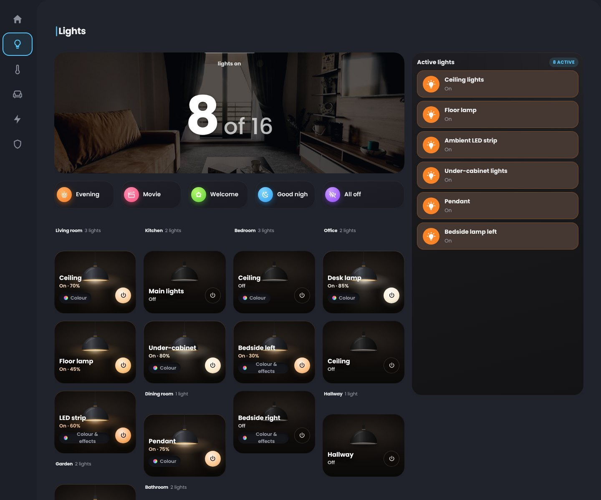 **Lights** , every light, scenes and what is on | 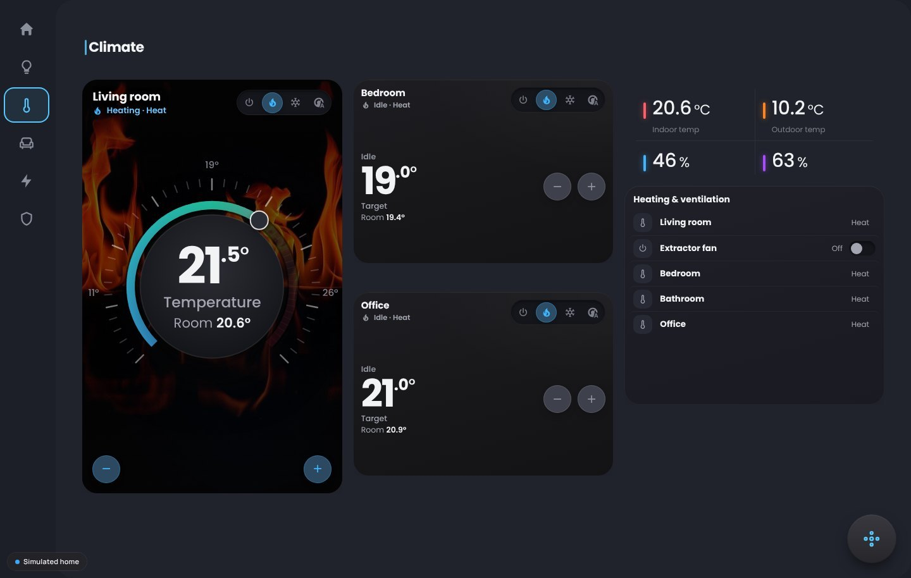 **Climate** , the main thermostat and the other units |
| 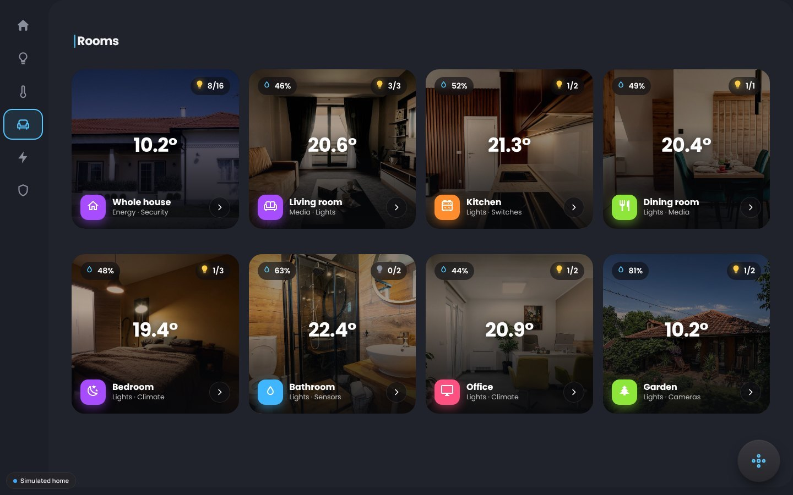 **Rooms** , photographic room cards | 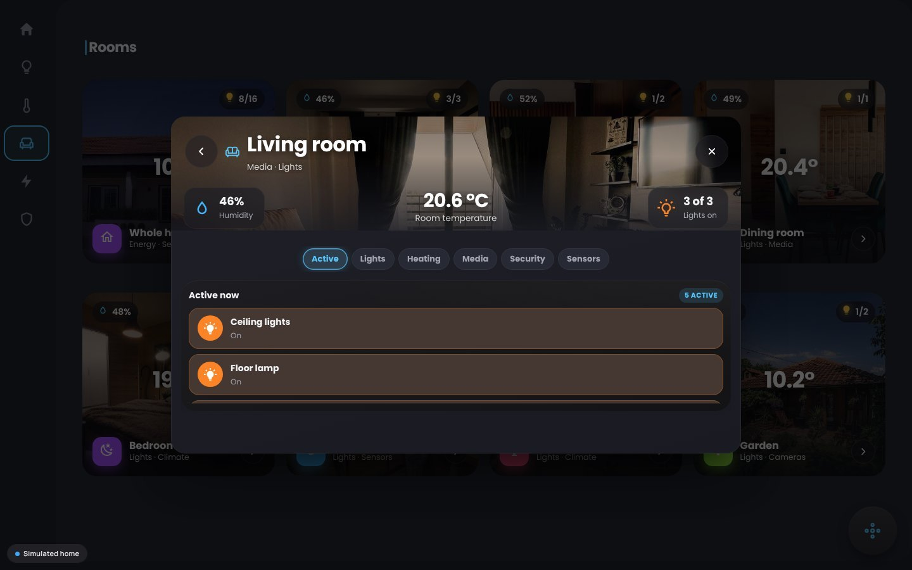 **Room popup** , compact tabs per room |
| 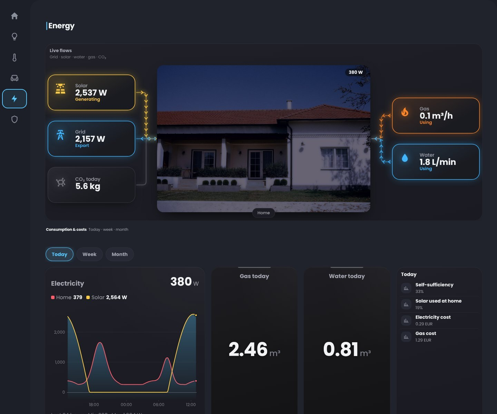 **Energy** , house-centred flow and consumption | 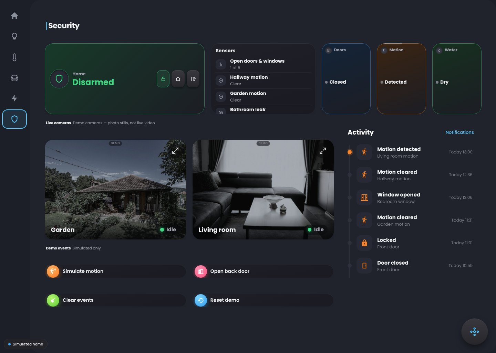 **Security** , alarm, sensors, cameras, activity |
| 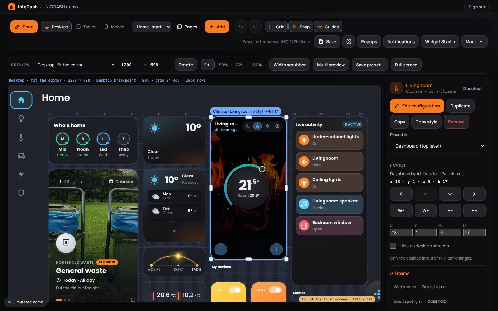 **Editor** , select, configure, arrange | 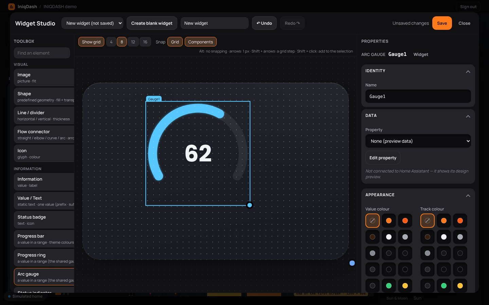 **Widget Studio** — build your own widgets |

<p align="center">
  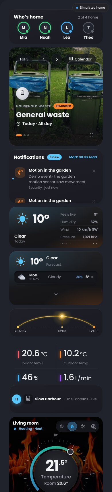
  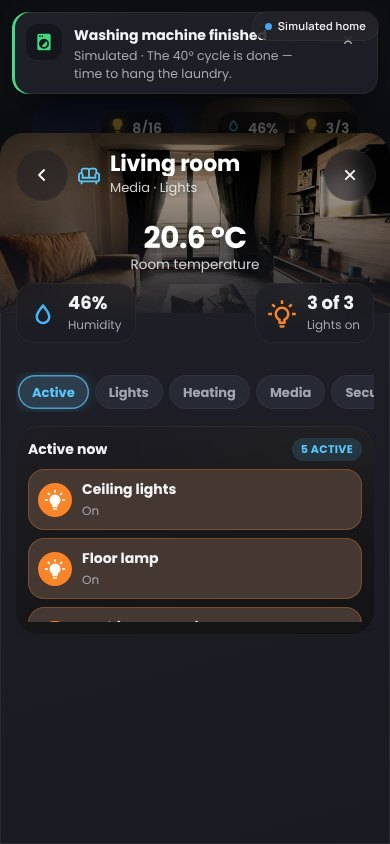
  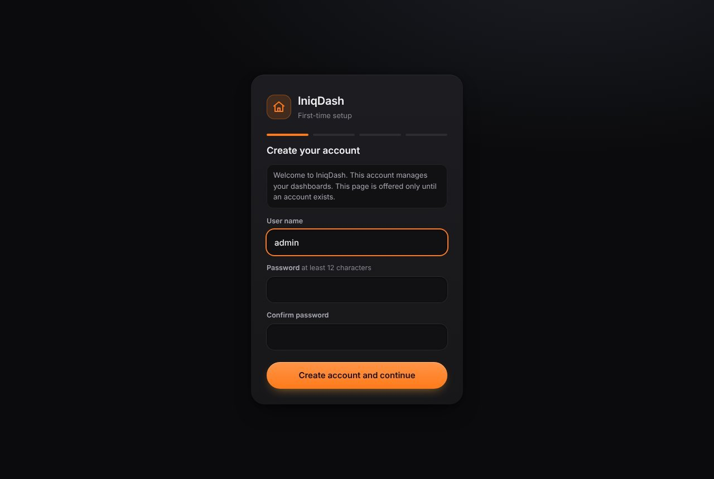
</p>

All screenshots show the built-in **demo home** , fictional rooms, people and devices, simulated by the server.

## Quick start

**You need:** a web server with **PHP 8.1 or newer** (Apache with `mod_rewrite`, or Nginx), **HTTPS**, and a Home Assistant you can
reach from that server (optional — the demo works without one).

1. **Download** `iniqdash-0.1.0-beta.1.zip` from [Releases](../../releases) and unpack it on your computer.
2. **Upload** the `iniqdash` folder to your web space, for example as `https://example.com/iniqdash/`.
3. **Open** that address in your browser. The installation wizard starts:
   1. create your administrator account;
   2. enter your Home Assistant address and a long-lived access token, and test the connection — or choose the demo;
   3. choose the rooms and pages for your first dashboard;
   4. finish — your dashboard opens.

INIQDASH creates its private data folder (account, token, dashboards) **outside the website** by itself. Details, server
configuration and shared hosting: [docs/installation.md](docs/installation.md). Problems: [docs/troubleshooting.md](docs/troubleshooting.md).

## Documentation

| | |
|---|---|
| [Installation](docs/installation.md) | requirements, upload, the private folder, the wizard, shared hosting |
| [Quick start](docs/quick-start.md) | the first ten minutes |
| [Home Assistant](docs/home-assistant.md) | access tokens, the connection, what INIQDASH reads |
| [Dashboard generator](docs/dashboard-generator.md) | what is generated and how entities are chosen |
| [Editor](docs/widget-editor.md) · [Widget Studio](docs/widget-studio.md) · [Widgets](docs/widgets.md) | building and changing dashboards |
| [Updating](docs/updating.md) · [Troubleshooting](docs/troubleshooting.md) · [Security](docs/security.md) | running it |
| [Contributing](CONTRIBUTING.md) · [Changelog](CHANGELOG.md) | development |

## Security

**Home Assistant is the backend. IniqDash is the frontend.** INIQDASH shows what Home Assistant reports and sends only the actions you
allow; it has no automation engine of its own. The Home Assistant address and token, your password hash and your dashboards live in a
private folder **outside the website**,
readable only by the web server's user. The token is used only by the server and is never sent to the browser, exported or logged.
Sign-in uses Argon2id password hashes, server-side sessions, CSRF protection and rate limiting. INIQDASH has **not** had an external
security review, and a long-lived Home Assistant token carries the rights of the user who created it — see
[docs/security.md](docs/security.md). Please report vulnerabilities privately: [SECURITY.md](SECURITY.md).

## Contributing

Bug reports, ideas and pull requests are welcome. There is no build step — vanilla JavaScript, CSS and PHP — and the tests run against
the real PHP server with a simulated Home Assistant, so you need no Home Assistant of your own:

```bash
git clone https://github.com/mjrymenhout-del/iniqdash-dashboard.git
cd iniqdash-dashboard
tests/run-all.sh
```

Start with [CONTRIBUTING.md](CONTRIBUTING.md). Issues labelled *good first issue* are a good way in.

## Support the project

INIQDASH is free and developed in the open. If it is useful to you and you would like to support its development, you can buy the
project a coffee — on GitHub also through the **Sponsor** button at the top of this page. Bug reports, ideas and pull requests help just as much.

<a href="https://buymeacoffee.com/iniqdash"></a>

The button is Buy Me a Coffee's own button image, shown from their site; *Buy Me a Coffee* is their trademark.

## Licence

INIQDASH is free software under the **Mozilla Public License 2.0** ([LICENSE](LICENSE)). You may use, study, change and redistribute it,
also commercially. If you distribute a modified version, the MPL-2.0 files you changed stay under MPL-2.0 and their source must be made
available; your own separate files (a custom widget package, for example) may use another licence.

Copyright © 2026 Marcel Rymenhout and IniqDash contributors.

## Acknowledgments

Bundled third-party material keeps its own licence: Material Design Icons (Apache-2.0), the Manrope and Poppins fonts (SIL Open Font
License 1.1) and photographs from Wikimedia Commons under their stated licences — see [THIRD-PARTY-NOTICES.md](THIRD-PARTY-NOTICES.md).
Browser tests use [Playwright](https://playwright.dev/).

INIQDASH is not affiliated with or endorsed by Home Assistant or the Open Home Foundation.

## Original Creator & Founder

**Marcel Rymenhout** founded and originally developed INIQDASH in 2026. Contributors are credited in the Git history and the changelog
and keep the copyright in their own contributions. The project's name and branding: [BRANDING.md](BRANDING.md).
