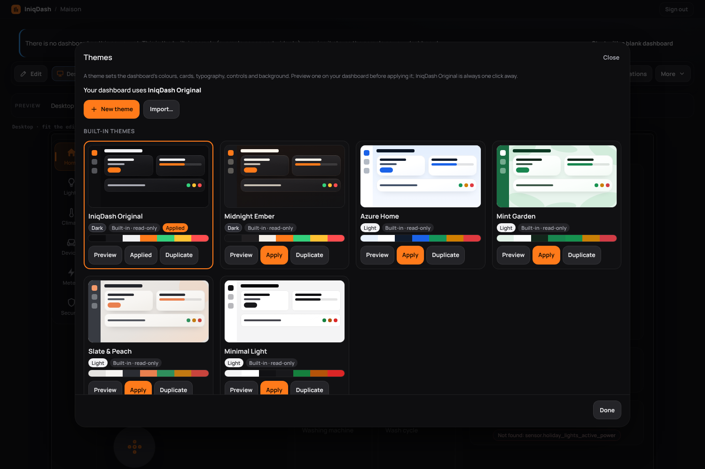
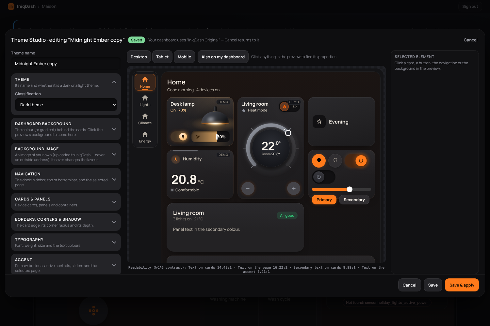
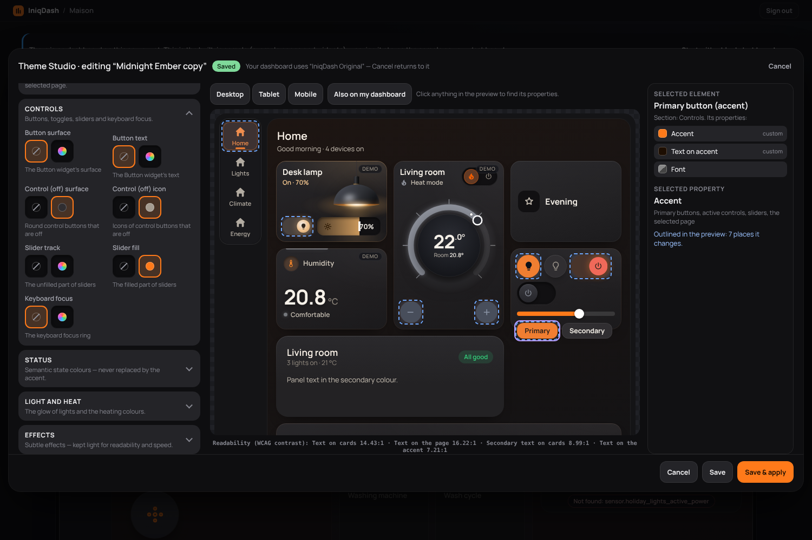
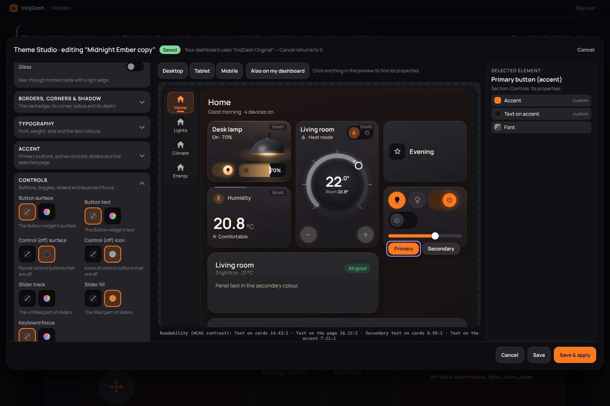
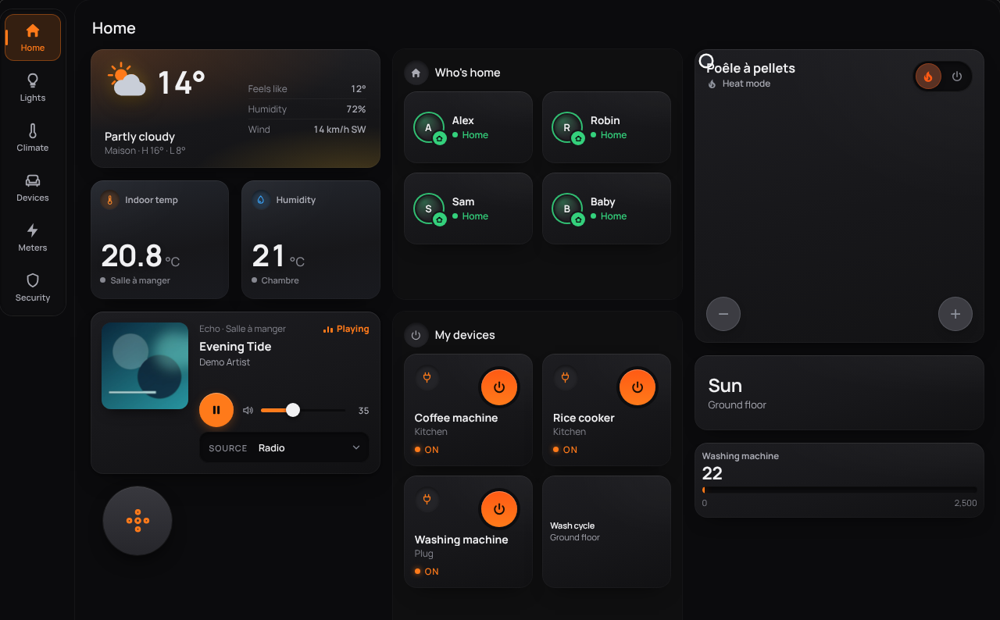
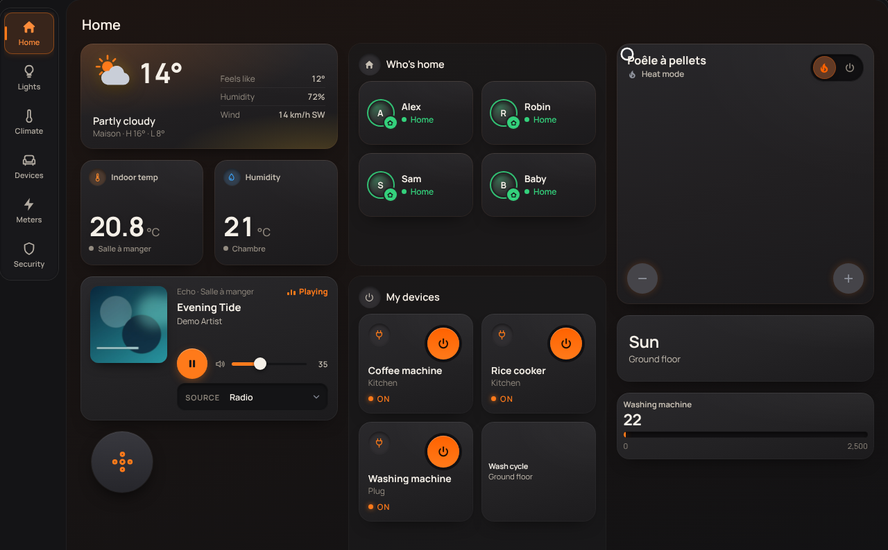
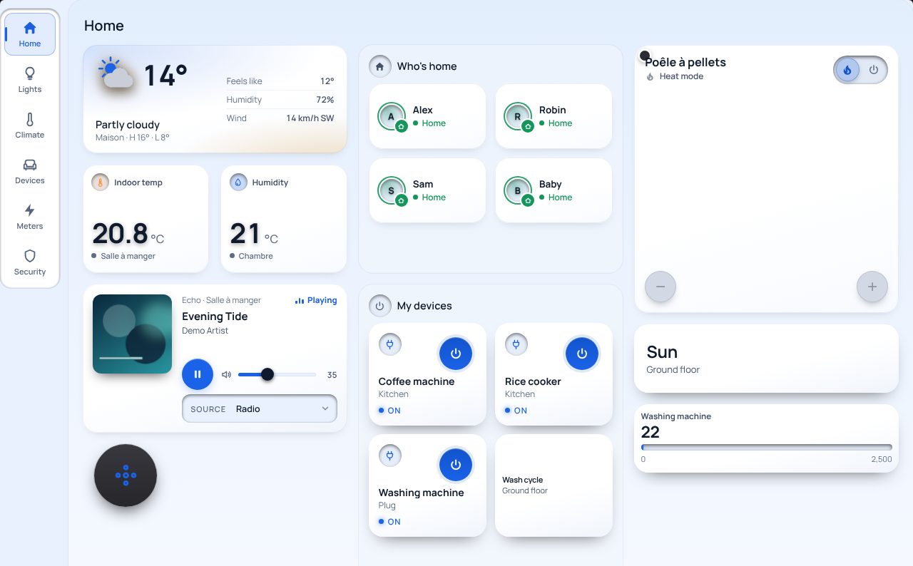
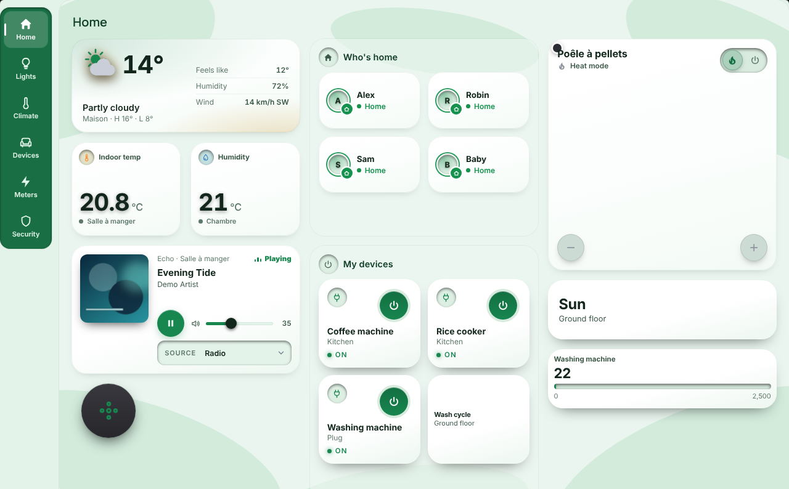
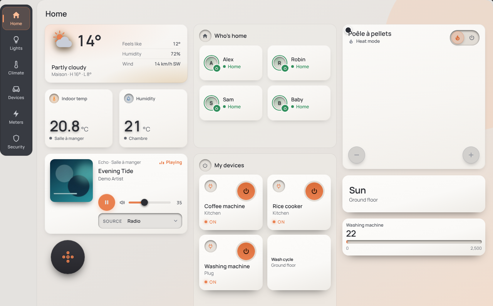
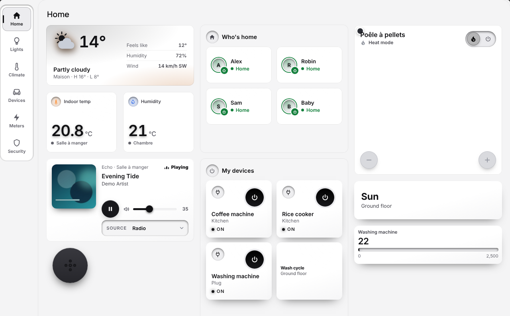

# Theme Studio — visual theme designer

More → **Themes…** opens the theme gallery; **Edit** on one of your own themes opens the Theme Studio. Everything here was tested
with the **fake Home Assistant** of the test suite (`tests/lib/live.mjs`) and the editor's built-in sample dashboard. **Nothing was
validated against a real Home Assistant.**



## Using it

| You want to… | Do this |
| --- | --- |
| See a theme on your dashboard | Gallery → **Preview**. A bar at the top says *Previewing “…” — not applied* with **Apply this theme** and **Cancel** (Escape = Cancel). Nothing is stored. |
| Use a theme | **Apply** (or Apply in the preview bar). Save the dashboard to keep it. |
| Go back to the original look | **Back to IniqDash Original** (gallery header), or Apply on the *IniqDash Original* card. |
| Customise a built-in theme | **Duplicate** it (built-ins are read-only), then **Edit** the copy. |
| Start from scratch | **New theme** (a copy of IniqDash Original). |
| Rename / export / delete | The buttons on your own theme's card (Delete: press twice). |
| Import | **Import…** and choose an `.iniqdash-theme.json` file. |
| Make one widget follow the theme again | The gallery lists **Widget overrides** (widgets with theme colours of their own) — **Use Theme Default**. |

### The Studio



- **Header:** *Theme Studio · editing “name”*, **Saved / Unsaved changes**, and which theme your dashboard uses (Cancel returns to it).
- **Left — properties** in collapsible sections (the same form, colour, image and slider + number controls as the widget, popup and
  notification editors): Theme (Dark / Light) · Dashboard background · Background image · Navigation · Cards & panels · Borders,
  corners & shadow · Typography · Accent · Controls · Status · Light and heat · Effects. Every colour has a **Default** (= the original
  value) — choosing it is "Use Theme Default" for that property.
- **Centre — live preview** built from real components: the navigation dock, Light / Climate / Button / Sensor cards, a panel
  (container) with a status chip, control buttons on / off and as switches, the shared slider, a primary and a secondary button, the six
  status colours. **Desktop / Tablet / Mobile** widths. **Also on my dashboard** shows the unsaved theme on the real dashboard behind
  the dialog too (switch it off for "preview only").
- **Right — selected element / property.**
  - **Click anything in the preview** (the background, a card, a button, the dock, a heading…): its section opens and the panel lists the
    properties that actually colour that element (measured — see below), each with its swatch and *custom / theme default*; click one to
    jump to it.
  - **Focus a property:** every element it changes is outlined in the preview, with a count (*Outlined in the preview: 4 places it changes*)
    and what the property is for.
- **Readability:** the WCAG contrast of text on cards, text on the page, secondary text on cards and text on the accent, with ⚠ below 4.5:1.
- **Cancel** (or Escape) restores everything; **Save** stores the theme; **Save & apply** also applies it to the dashboard.

 

## The built-in themes

| Theme | Kind | Character |
| --- | --- | --- |
| **IniqDash Original** | Dark | The original look, exactly: it stores **no value** — it *is* `assets/css/tokens.css`. The default for every dashboard. |
| **Midnight Ember** | Dark | Warm charcoal, warm orange accent with a soft glow, warm gradient background, 18 px corners. |
| **Azure Home** | Light | White cards on a soft blue background, vivid blue accent and selected page, fine borders, soft shadows, 20 px corners. |
| **Mint Garden** | Light | Mint background with a leaf image, white rounded cards (24 px), a green navigation dock, rounded font. |
| **Slate & Peach** | Light | Slate dock with peach selection, warm light cards, peach accent with dark text on it, warm background image. |
| **Minimal Light** | Light | White / soft grey, near-black accent, fine 1 px borders, no shadow, system font, 12 px corners. |

| | |
| --- | --- |
|  |  |
|  |  |
|  |  |

Mobile: `docs/theme-studio/theme-*-mobile.png`.

## How it works

### Data (components/theme/theme.js)

```
app.theme   = { id, name, base?, dark?, tokens, look?, background? }   the applied theme (a copy; absent = IniqDash Original)
app.themes  = [ the same, … ]                                          your library (≤ 20, unique ids)
item.config.theme = { tokens }                                         a widget's own override
```

- **tokens** — allow-listed colour tokens (50; plain `#hex` / `rgb()` / `rgba()` / `hsl()` / `hsla()` only). New in V2, each with a
  CSS fallback equal to what that element showed before: `nav-active`, `nav-active-bg`, `nav-inactive`, `nav-indicator`,
  `text-heading`, `card-border`, `slider-track`, `slider-fill`, `button-bg`, `button-fg`, `control-off-bg`, `control-off-fg`, `focus`.
- **look** — `font` (named, safe local font stacks — nothing downloaded), `titleWeight` 500–800, `textScale` 0.9–1.15, `radius` 0–32,
  `borderWidth` 0–3, `shadow` none / soft / standard / strong, `shadowStrength` 0–150 %, `surfaceAlpha` 40–100 %, `blur` 0–20 px, `glass`,
  `glow` 0–100 %.
- **background** — `image` (an IniqDash asset reference only: `assets/…`, a widget package asset, or an uploaded
  `api/asset.php?id=<32 hex>` — never an outside address, never embedded data), `fit` cover / contain / original / stretch, `position`
  (9), `opacity`, `overlay` + `overlayAlpha`, `blur`, `attach` scroll / fixed, `gradient` { from, to, angle }.
- Every CSS value is **built by theme.js from those bounded numbers and fixed strings**; a theme never carries CSS. `check()` refuses
  unknown keys / properties, out-of-range values, `url()`, `var()`, `calc()`, markup and outside addresses; `clean()` drops them;
  `server/Dashboards.php` (`checkTheme`) applies the same rules on save, so a file that bypasses the editor is refused too.

### Inheritance

Theme (`app.theme`, on the dashboard surface, the popup layer and the notification layer) → the dashboard's own page choice
(Default / Darker / Lighter background) → a widget's own theme (`config.theme`, on that widget's root — it wins for that widget) →
the element's explicit colours in the widget's configuration (inline, always win). Token-based colours follow the theme; an explicit
colour chosen in a widget is never overwritten. There is one theme engine: CSS custom properties.

### Painting only — no geometry

The look changes colours, shadows (box-shadow), corner radii, fonts, filters; the background is painted by absolutely positioned
pseudo-elements of the dashboard canvas behind the content. Grid geometry, positions and drag-and-drop are untouched
(`tests/theme-collection.mjs`, `tests/theme-background.mjs` compare every grid item's box). A theme that changes the **font** changes
text widths, so a dock button sized by its label can change by a pixel.

### "Affected elements"

Not a hand-written map: the Studio sets the property to a probe value on the preview for an instant (transitions off), compares every
preview element's computed colour, background, border, shadow, fill, stroke, font, radius and filter, and puts it back. Click-to-select
does the same for the clicked element against every token and the main look properties.

### Widget compatibility

Shared hooks: the navigation dock, the shared control button (off state), the shared slider (track / fill), the Button widget (surface /
text), containers and panels, device cards (surface gradient, border, radius, shadow), headings, focus ring. Status colours stay status
colours (never replaced by the accent). Under a theme the Sensor card uses the shared card surface (with no theme it keeps its own
gradient). Room / Light / Climate / Popup keep their approved look and only follow the tokens they already used (snapshot: pixels
identical without a theme). Widgets with hard-coded colours of their own (e.g. the radial menu's face, the Button widget's "on" state)
keep them under every theme.

## Tests (fake Home Assistant)

| Suite | What |
| --- | --- |
| `tests/theme.mjs` | Pure rules (V1 + V2: look, background, refusals), server parity (PHP), apply / save / reload / import in the editor. |
| `tests/theme-studio.mjs` | Gallery, preview / cancel / apply, back to Original (pixels), duplicate, Studio panes, click-to-select, affected outlines, live + unsaved, sizes, cancel, save & apply, inheritance + Use Theme Default, rename, export / import (refusals), delete, save + reload. |
| `tests/theme-background.mjs` | Image picker (built-in + upload to the protected asset store), every option, layout untouched, three sizes, save / reload, export carries only the reference, remove. |
| `tests/theme-collection.mjs` | All six themes at desktop / tablet / mobile: no geometry change, six different dashboards, contrast ≥ 4.5:1, back to Original pixel-identical. |
| `tests/theme-original.mjs <dir>` | Full-dashboard screenshots + geometry signature (frozen clock) — run on the commit before the theme work and on this one, compare with `node tests/lib/snapshot.mjs --compare`: **identical** (12 views). |

## Applying a theme — one authority, immediate everywhere

**Root causes of "some widgets keep their old look; a resize sometimes fixes it"** (found with `tests/theme-apply.mjs`, which compares
each widget right after a theme change with a fresh render under that theme):

1. **The widget surface layer held resolved colours.** `IniqWidgetKit.surface()` — used by every widget whose Appearance has a hover
   effect (Surface, Glow, Lift…) or a widget background other than Theme (Transparent, Custom opacity) — copies the root's *computed*
   background and shadow into a layer as fixed inline values. It re-read them only when the widget's own attributes / children changed
   or when its size changed (ResizeObserver). A theme put on the dashboard changes neither, so those widgets stayed in the old theme until
   a resize happened to re-run the copy — and a resize that did not change their box did nothing. On the sample, with the old code,
   Climate, Person, Live Activity and the Lights with a hover effect (also nested and in an inactive tab) stayed stale indefinitely.
2. **Previews were drawn outside the themed dashboard.** The Add / configure Live preview, the collection item editors' preview, the
   Multi preview, the Widget Studio canvas and the popup / notification previews live in dialogs or panels outside the dashboard frame,
   which was the only element carrying the theme — so they always showed IniqDash Original.
3. **Uneven fades.** Widgets animate their own state changes (`transition` on background / colour / shadow); a theme change made some
   parts fade through in-between colours for 0.2–0.3 s while others switched at once.

**How it works now** (`components/theme/theme.js`):

- `MaisonTheme.setActive(theme, roots)` — the editor's applied (or live-previewed) dashboard theme, put on the dashboard frame, the popup
  and notification layers **and every registered scope**. One theme computation for all of them.
- `MaisonTheme.scope(el)` — a preview host registers once and always shows the active theme: the configure / Add Live preview and the item
  editors (`configure.js` widgetView — the one drawing they share), the Multi preview frames, the Widget Studio canvas, the popup and
  notification previews. A widget's own theme and explicit colours still win inside them, exactly as on the dashboard. Nothing is
  applied or saved by opening a preview.
- **Theme readers** — the rare code that copies *resolved* colours (the widget surface layer) marks its element `data-theme-reads` and
  gives it a refresh function; when a theme is put on or taken off a root, every such element inside it reads again on the next frame.
  They are found in the DOM, not kept in a registry (scopes are held weakly), so a removed widget or preview is never kept alive.
  Everything else needs nothing: CSS custom properties update every element at once, including nested containers, popups and hidden
  tabs.
- A real theme change suspends transitions on the themed roots for two frames (`data-theme-switching`), so every element switches in the
  same frame. Re-applying the same theme (the editor does on every render) changes nothing and suspends nothing.
- No resize, no re-render, no rebuild: widget state, Home Assistant subscriptions, control values, positions and sizes are untouched
  (`tests/theme-apply.mjs` checks no resize event and identical boxes).

The Add Widget **gallery list** shows each widget type as an icon (no widget is rendered there); the rendered preview appears as soon as a
type is chosen, in the dashboard's theme.

## Limits

- **Fixed** background: the stored setting and the CSS (`background-attachment: fixed`) are verified; how it looks while scrolling was
  not checked by eye — inside a scaled (transformed) preview frame browsers draw it like a scrolling image. Blur is not combined with a
  fixed image.
- Backdrop blur and glass cost GPU time on older tablets (the help text says so); both are off in every built-in theme.
- Themes per widget **type** (the `type` slot of `MaisonTheme.resolve`) and a widget-level theme editor are not built: a widget's own
  override can be reset (Use Theme Default) but is created only by import / API.
- Input fields inside widgets use the "Wells and tracks" colour; there is no separate input-surface token.
- Widgets that draw hard-coded colours keep them (see Widget compatibility).
