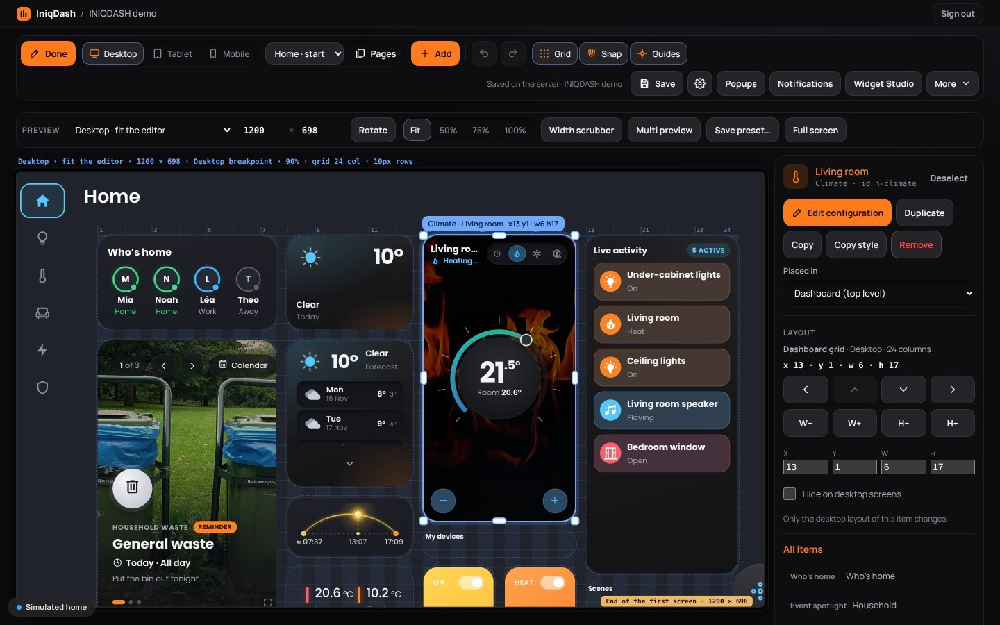

# The editor

**Open it:** rest the pointer in the top-right corner for 2 seconds (press and hold on a touch screen) → **Edit**, or make the Edit
button always visible (Dashboard settings → Editing). **Done** saves.

## Basics

| | |
|---|---|
| **Add a widget** | **Add** → pick from the gallery (search, categories) → choose its entity → place it |
| **Select** | click a widget; **Shift**-click to select several |
| **Move / resize** | drag the widget; drag its corner; arrow keys move it one step |
| **Configure** | **Edit configuration** — what it shows (entities, names, icons), its variant, its **Appearance** |
| **Copy, duplicate, remove** | the buttons beside the selection; **Ctrl/⌘ + Z** undoes |
| **Containers** | group widgets in a container or a tabbed container; drag widgets in and out |
| **Screens** | **Desktop**, **Tablet** and **Mobile** each have their own layout; the phone layout can be generated from the desktop one |
| **Pages** | **Pages** — add, rename, reorder, choose which appear in the navigation dock |

## Beyond widgets

- **Popups:** **Popups** — design popups (room details, climate…) and open them from any widget's tap action. [POPUPS.md](POPUPS.md)
- **Notifications:** **Notifications** — rules that turn Home Assistant events into notifications, and the notification centre.
  [NOTIFICATIONS.md](NOTIFICATIONS.md)
- **Themes:** **More → Themes…** — colours, fonts, corners, shadows, backgrounds for the whole dashboard. [THEME-STUDIO.md](THEME-STUDIO.md)
- **Dashboards:** **More → Dashboards…** — several dashboards, a default one, import / export as a file.

The complete guide: [USER-GUIDE.md](USER-GUIDE.md). Appearance options: [APPEARANCE.md](APPEARANCE.md).
