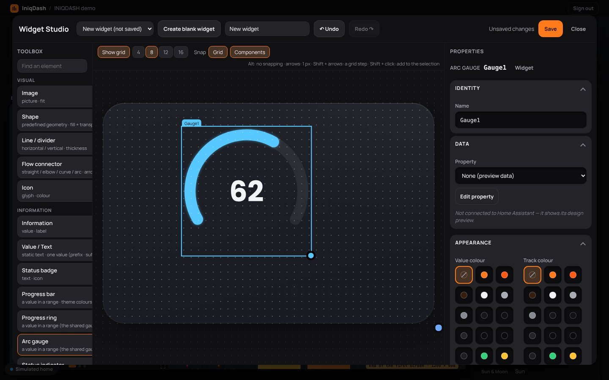

# Widget Studio

Widget Studio lets you **compose your own widgets** from INIQDASH's building blocks and reuse them on any dashboard.

**Open it:** in the editor, **Widget Studio**.

- **Toolbox** — visual elements (images, shapes, lines, flow connectors, icons), information (values, status badges, progress bars and
  rings, gauges) and controls (buttons, sliders, toggles).
- **Canvas** — place, resize and align the elements; snapping to a grid; undo / redo.
- **Properties** — each element's content and appearance, and the **data** it shows or controls: bind it to a property of your widget,
  then choose the Home Assistant entity per copy of the widget on a dashboard.
- **Library** — save the widget into a collection; it appears in the editor's widget gallery like a standard widget. Export and import
  widget definitions as files.

Studio widgets are made of INIQDASH's own components; they do not run code of their own. (Installable *custom widget packages* are
different — they contain code; see [CUSTOM-WIDGETS.md](CUSTOM-WIDGETS.md) and install only packages you trust.)

More detail: [WIDGET-STUDIO-POC.md](WIDGET-STUDIO-POC.md).
