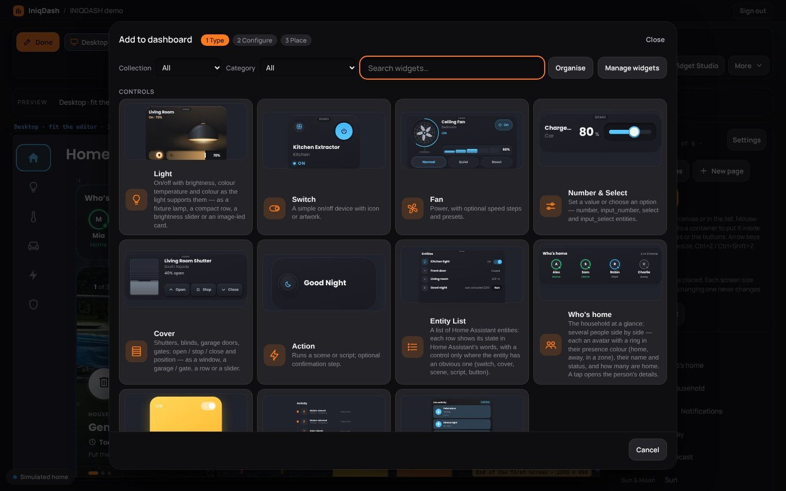

# Widgets

INIQDASH ships more than 40 standard widget types. Each has **variants** (for example a light as a compact card, a slider or a
picture), adapts to the size you give it, and shows a control only when Home Assistant says the device supports it.

| Group | Widgets |
|---|---|
| **Devices** | Light, Switch, Fan, Cover, Lock, Climate, Climate group, Humidifier, Media player, Robot vacuum, Appliance, Vehicle, Device tile, Number & Select, Button, Action |
| **Readings** | Sensor, Readings, Gauge, Chart, Batteries, Energy flow, Home battery, Solar, Weather, Sun & Moon |
| **Home** | Room card, Who's home, Person, Alarm, Camera, Calendar, To-do list, Updates, Activity, Activity log, Event spotlight, Entity list |
| **Layout & navigation** | Text, Image, Date & time, Countdown, Timer, Container, Tabbed container, Floating container, Radial menu, Notification centre |

Every widget's configuration and options: [WIDGET-REFERENCE.md](WIDGET-REFERENCE.md). Styling (gradients, pictures, borders, glow):
[APPEARANCE.md](APPEARANCE.md). Your own widgets: [widget-studio.md](widget-studio.md).
